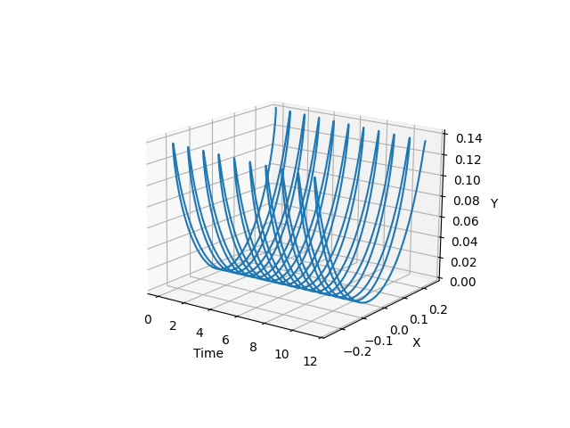

# Cycloidal isochronous pendulum simulator
C++ and Python numerical simulation for a cycloidal pendulum's motion, with the effects of aerodynamic drag and friction between the string and the cheeks, validated by empirical data.
This repository is part of the bachelor thesis "The isochronous pendulum" by Diego Catellani.



## Requirements:
* **C++ standard:** C++20 Standard
* **Python libraries:** `matplotlib`, `csv`

## Physical model:
**Equation of motion:** $m\ddot{s} + m\frac{g}{4R}s + \frac{1}{2}\rho C_{D,\text{sphere}} A_{\text{sphere}} \dot s^2 \text{sgn}(\dot s) + \frac{1}{2}\rho D \dot\theta^2\int\limits_0^{\sqrt {16R^2-s^2}}C_D(p)p^2dp + \mu_{eq}m(g \cos(\theta) + \frac{v^2}{P(s)})  = 0$

- Wire-cheek friction: $\mu_{eq}m(g\cos(\theta) + \frac{v^2}{P(s)})$
    - $\mu_{eq}$ is calculated by comparing energy dissipation in the numerical simulation with data extracted from video tracking the physical pendulum.
    - The formulation follows Meriam and Kraige description. [1]
- Drag on the sphere: $\frac{1}{2}\rho C_{D, \text{sphere}} A_{\text{sphere}} \dot s^2 \text{sgn}(\dot s)$
    - $C_D$ is calculated with Stokes's regime ($\text{Re} < 1$) [4], and White's regime ($1\le \text{Re}\le 2\cdot 10^5$) [5].
- Drag on the wire: $\frac{1}{2}\rho D \dot\theta^2\int\limits_0^{\sqrt {16R^2-s^2}}C_{D, \text{wire}}(p)p^2dp $
    - $C_D$ was calculated with the Nelson and Olsson approximation ($\text{Re} < 10^{-4}$) [2], and Sucker and Brauer best-fit curve ($10^{-4} \le \text{Re} \le 2\cdot 10^5$) [3]
The drag crisis of both the sphere and the wire is negligible since the $Re$ peaks at around 2000.

## Numerical method:
- The Runge-Kutta-Fehlberg method, also known as RK45, was implemented with tolerances.
- RK45 is an adaptive step method, balancing computational efficiency for the more linear parts (the center of the swing) with high precision at the inversion points.
- Upper and lower limits for the temporal step were added to balance precision and efficiency.
- Regularization of $\text{sgn}(\dot s)$ function with $\frac{2}{\pi}\arctan(\frac{\dot s}{\varepsilon})$ (otherwise, at inversion points, the absolute error wouldn't decrease with a shorter step).

## Using the code
Parameters can be defined in the `config.txt` file.

```bash

git clone https://github.com/catellanidiego/bachelor_thesis

cd bachelor_thesis

mkdir build

cd build

cmake ..

make

./main

```

## Results and Visualization

**Output Data:** The simulation results are exported in '.csv' format.

**Graphs:** Kinematics plots can be generated by running the Python scripts located in the 'src' directory.

## $\mu_{eq}$ Calculation

```bash

cd build

./data_for_mu_eq

./mu_eq

```

## Testing

Tests can be launched directly from the terminal.

```bash

cd build

ctest

```
This repository also contains a .cpp script to calculate the period of a pendulum for tracker data.

## Repository organization
```text
 |-CMakeLists.txt
 |-config.txt
 |-csv
 | |-C_big_1.csv
 | |-C_big_10.csv
 | |-C_big_2.csv
 | |-C_big_3.csv
 | |-C_big_4.csv
 | |-C_big_5.csv
 | |-C_big_6.csv
 | |-C_big_7.csv
 | |-C_big_8.csv
 | |-C_big_9.csv
 | |-C_small_1.csv
 | |-C_small_10.csv
 | |-C_small_11.csv
 | |-C_small_2.csv
 | |-C_small_3.csv
 | |-C_small_4.csv
 | |-C_small_5.csv
 | |-C_small_6.csv
 | |-C_small_7.csv
 | |-C_small_8.csv
 | |-C_small_9.csv
 | |-Data_cycloidal_pendulum.csv
 | |-Data_for_comparison.csv
 | |-prova.csv
 | |-S_big_1.csv
 | |-S_big_10.csv
 | |-S_big_2.csv
 | |-S_big_3.csv
 | |-S_big_4.csv
 | |-S_big_5.csv
 | |-S_big_6.csv
 | |-S_big_7.csv
 | |-S_big_8.csv
 | |-S_big_9.csv
 | |-S_small_1.csv
 | |-S_small_10.csv
 | |-S_small_2.csv
 | |-S_small_3.csv
 | |-S_small_4.csv
 | |-S_small_5.csv
 | |-S_small_6.csv
 | |-S_small_7.csv
 | |-S_small_8.csv
 | |-S_small_9.csv
 |-Energy_data.png
 |-figure_readme.png
 |-include
 | |-Calculate_a_D_sphere_no_Stokes.hpp
 | |-Calculate_a_D_sphere_Stokes.hpp
 | |-Calculate_a_D_wire.hpp
 | |-Calculate_a_friction.hpp
 | |-Calculate_C_D_sphere_White.hpp
 | |-Calculate_C_D_wire.hpp
 | |-Calculate_K.hpp
 | |-Calculate_Re.hpp
 | |-Calculate_U.hpp
 | |-CSV_Reader.hpp
 | |-CSV_Writer.hpp
 | |-CycloidalPendulum.hpp
 | |-F_cycloidal_pendulum.hpp
 | |-F_test.hpp
 | |-Is_close.hpp
 | |-Load_config.hpp
 | |-parameters.hpp
 | |-RK45_Solver.hpp
 | |-Solution_type.hpp
 | |-Timecounter.h
 |-main.cpp
 |-prova.csv
 |-README.md
 |-src
 | |-Calculate_mu_eq.cpp
 | |-Calculate_T.cpp
 | |-Comparison_plot_t_E.py
 | |-desktop.ini
 | |-Plot_theta_omega.py
 | |-Plot_t_E.py
 | |-Plot_t_x_y.py
 | |-Plot_x_y.py
 | |-Read_data_for_mu_eq_search.cpp
 | |-Timecounter.cpp
 | |-togli.py
 |-test
 | |-Test_Calculate_a_D_no_Stokes.cpp
 | |-Test_Calculate_a_D_Stokes.cpp
 | |-Test_Calculate_a_D_wire.cpp
 | |-Test_Calculate_a_friction.cpp
 | |-Test_Calculate_C_D_wire.cpp
 | |-Test_Calculate_K.cpp
 | |-Test_Calculate_Re.cpp
 | |-Test_Calculate_U.cpp
 | |-Test_RK45.cpp
pcsdocker@THIS_IS_PCS_DOCKER:~/Data/tesi$ vi albero.txt
pcsdocker@THIS_IS_PCS_DOCKER:~/Data/tesi$ cat albero.txt
 |-CMakeLists.txt
 |-config.txt
 |-csv
 | |-C_big_1.csv
 | |-C_big_10.csv
 | |-C_big_2.csv
 | |-C_big_3.csv
 | |-C_big_4.csv
 | |-C_big_5.csv
 | |-C_big_6.csv
 | |-C_big_7.csv
 | |-C_big_8.csv
 | |-C_big_9.csv
 | |-C_small_1.csv
 | |-C_small_10.csv
 | |-C_small_11.csv
 | |-C_small_2.csv
 | |-C_small_3.csv
 | |-C_small_4.csv
 | |-C_small_5.csv
 | |-C_small_6.csv
 | |-C_small_7.csv
 | |-C_small_8.csv
 | |-C_small_9.csv
 | |-Data_cycloidal_pendulum.csv
 | |-Data_for_comparison.csv
 | |-prova.csv
 | |-S_big_1.csv
 | |-S_big_10.csv
 | |-S_big_2.csv
 | |-S_big_3.csv
 | |-S_big_4.csv
 | |-S_big_5.csv
 | |-S_big_6.csv
 | |-S_big_7.csv
 | |-S_big_8.csv
 | |-S_big_9.csv
 | |-S_small_1.csv
 | |-S_small_10.csv
 | |-S_small_2.csv
 | |-S_small_3.csv
 | |-S_small_4.csv
 | |-S_small_5.csv
 | |-S_small_6.csv
 | |-S_small_7.csv
 | |-S_small_8.csv
 | |-S_small_9.csv
 |-Energy_data.png
 |-figure_readme.png
 |-include
 | |-Calculate_a_D_sphere_no_Stokes.hpp
 | |-Calculate_a_D_sphere_Stokes.hpp
 | |-Calculate_a_D_wire.hpp
 | |-Calculate_a_friction.hpp
 | |-Calculate_C_D_sphere_White.hpp
 | |-Calculate_C_D_wire.hpp
 | |-Calculate_K.hpp
 | |-Calculate_Re.hpp
 | |-Calculate_U.hpp
 | |-CSV_Reader.hpp
 | |-CSV_Writer.hpp
 | |-CycloidalPendulum.hpp
 | |-F_cycloidal_pendulum.hpp
 | |-F_test.hpp
 | |-Is_close.hpp
 | |-Load_config.hpp
 | |-parameters.hpp
 | |-RK45_Solver.hpp
 | |-Solution_type.hpp
 | |-Timecounter.h
 |-main.cpp
 |-prova.csv
 |-README.md
 |-src
 | |-Calculate_mu_eq.cpp
 | |-Calculate_T.cpp
 | |-Comparison_plot_t_E.py
 | |-desktop.ini
 | |-Plot_theta_omega.py
 | |-Plot_t_E.py
 | |-Plot_t_x_y.py
 | |-Plot_x_y.py
 | |-Read_data_for_mu_eq_search.cpp
 | |-Timecounter.cpp
 |-test
 | |-Test_Calculate_a_D_no_Stokes.cpp
 | |-Test_Calculate_a_D_Stokes.cpp
 | |-Test_Calculate_a_D_wire.cpp
 | |-Test_Calculate_a_friction.cpp
 | |-Test_Calculate_C_D_wire.cpp
 | |-Test_Calculate_K.cpp
 | |-Test_Calculate_Re.cpp
 | |-Test_Calculate_U.cpp
 | |-Test_RK45.cpp
```

## Known limitations
* **Rigid String Assumption:** The model assumes the pendulum's wire is inextensible and has zero torsional stiffness. The trajectory is assumed to be an ideal cycloid.
* **Friction Lumping:** The complex micromechanical hysteresis of the wire winding and unwinding around the cycloidal cheeks is lumped into a single equivalent Coulomb dry friction coefficient ($\mu_{eq}$). 
* **RK45 Discontinuity Error:** To prevent the RK45 solver from freezing at the inversion points (where velocity is zero and the friction term causes a mathematical discontinuity), a minimum time step ($h_{min}$) is strictly enforced.
* **2D Planar Motion:** The simulation strictly models 2D planar motion, deliberately ignoring secondary 3D phenomena such as minor lateral swinging or the Foucault effect.

## References
1. J.L. Meriam, L. G. Kraige, *Engineering Mechanics: Statics*, 7th Edition, Chapter 6, Section 9. 
2. R. A. Nelson, M. G. Olsson, "The pendulum—Rich physics from a simple system," *American Journal of Physics* 54, 112 (1986).
3. D. Sucker, H. Brauer, "Fluiddynamik bei quer angeströmten Zylindern," *Wärme- und Stoffübertragung* 8, 149–158 (1975).
4. G. G. Stokes, "On the Effect of the Internal Friction of Fluids on the Motion of Pendulums," *Transactions of the Cambridge Philosophical Society*, vol. 9, pp. 8-106, 1851.
5. F. M. White, *Fluid Mechanics*, 8th Edition, McGraw-Hill Education, 2015. 
